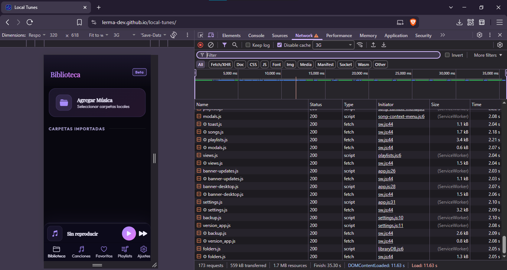
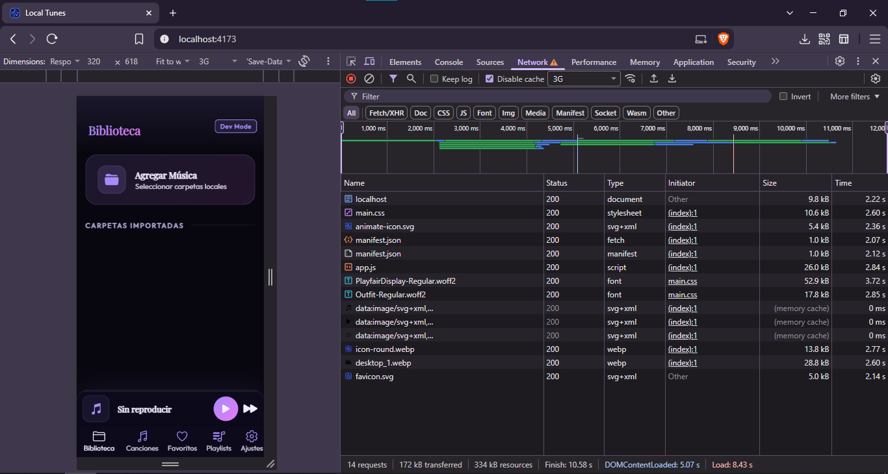

# 🎵 Local Tunes — Modern Web Music Player (PWA)

Un reproductor de música web de alto rendimiento diseñado para gestionar librerías masivas de forma local, local-first y 100% libre de publicidad o telemetría.

## 🌐 Accede a la Aplicación & Descargas

<a href="https://local-tunes.netlify.app">
  
</a>

<a href="https://lerma-dev.github.io/local-tunes/">
  
</a>

<a href="https://github.com/lerma-dev/local-tunes-desktop/releases/latest/download/LocalTunes-setup.exe">
  
</a>

---

- 🚀 **Producción (Estable):** Rama `prod`, generada con GitHub Actions (acción manual del mantenedor) y servida por `Netlify`.
- 🧪 **Beta (Experimental):** Rama `beta`, generada automáticamente con GitHub Actions al actualizarse `main` y servida por `GitHub Pages`.

> Las ramas `beta` y `prod` contienen únicamente la carpeta `dist/` (la app ya compilada y minificada). No se edita código en ellas.

> <br> ⚡ **Entorno Local Automatizado:**
> El registro del Service Worker (un `<script>` al final de `index.html`) detecta automáticamente mediante el `hostname` si estás trabajando en un entorno de desarrollo local (`localhost`, `127.0.0.1`, etc.) para deshabilitar el Service Worker en tiempo de ejecución. **Ya no es necesario comentar la etiqueta script.**
> <br>

---

## 🚀 Características Principales

- **Alto Rendimiento:** Implementación de **Virtual Scrolling** (Intersection Observer) para renderizar miles de canciones con 0% de lag.
- **Persistencia Local:** Base de datos **IndexedDB** para almacenar metadatos. Tu librería carga al instante desde el primer segundo.
- **Carga por Directorios:** Integración con **`webkitdirectory`** para importar colecciones y carpetas completas de música locales de forma inmediata.
- **Privacidad Absoluta:** Filosofía _local-first_. Todo el procesamiento ocurre de forma interna en el navegador; ningún dato o archivo se transfiere a servidores externos.
- **Experiencia de Usuario Avanzada:**
  - Visualizador de audio en tiempo real basado en frecuencias.
  - Sistema de favoritos persistente.
  - Buscador inteligente e instantáneo.
  - Animaciones de texto (Marquee) dinámicas para títulos largos.
- **Ecosistema PWA:** Completamente instalable como aplicación nativa en Android y entornos de escritorio.

## 🛠️ Tecnologías Utilizadas

- **Vanilla JS:** Código limpio y directo, sin frameworks pesados para garantizar la máxima velocidad de ejecución.
- **IndexedDB:** Almacenamiento NoSQL nativo del navegador.
- **Web Audio API:** Procesamiento avanzado de sonido y ecualización.
- **CSS3 Moderno:** UI responsiva con variables nativas y soporte completo para modo oscuro.

---

## 📦 Entorno de Desarrollo Local

### 1. Clonar el repositorio

```bash
git clone [https://github.com/lerma-dev/local-tunes.git](https://github.com/lerma-dev/local-tunes.git)
cd local-tunes
npm install
code .
```

### Pre-requisitos

> [!IMPORTANT]
> Antes de iniciar, necesitas tener instalado **Node.js**. Si no lo tienes, descárgalo e instálalo desde [nodejs.org](https://nodejs.org/).

**Verifica que se instaló correctamente:**

```bash
node --version
npm --version
```

---

### 2. Inicia el servidor de desarrollo:

```bash
npm run dev
```

### 3. Accede a la App:

Abre tu navegador en http://localhost:5173

### 4. Compila y prueba la versión optimizada

Lo que se publica no es la carpeta `app/` tal cual, sino el resultado del build (`dist/`): JS en un solo archivo, CSS unido, HTML con las vistas incrustadas e iconos SVG en línea.

```bash
npm run build     # genera dist/ (minificado)
npm run preview   # sirve dist/ en http://localhost:4173
```

> `dist/` es un resultado generado: **no se sube al repositorio** (está en `.gitignore`).

---

## ⚡ Optimización de recursos (obligatorio)

Local Tunes está pensada para cargar rápido incluso en redes lentas (3G). Cada KB cuenta, así que **todo recurso que subas debe estar optimizado al mínimo posible antes de hacer el commit**. Los PR con recursos sin optimizar se pedirán de vuelta.

### Pesos objetivo

| Recurso | Formato | Objetivo |
|---|---|---|
| Capturas del manifest (móvil) | `.webp` | 15–25 KB cada una |
| Captura del manifest (escritorio) | `.webp` | ≤ 30 KB |
| Iconos de la app / PWA | `.webp` | ≤ 20 KB (el de 512 px, ≤ 75 KB) |
| Iconos de interfaz (`assets/lerma-icons/`) | `.svg` | ≤ 1–2 KB cada uno |
| Logos y otros SVG | `.svg` | ≤ 5 KB |
| Fuentes | `.woff2` recortada a caracteres latinos | ≤ 55 KB cada una |

> **Ojo con los iconos SVG:** al compilar, *todos* los de `assets/lerma-icons/` se incrustan dentro de `app.js`, y los que están escritos en el HTML se convierten en `<svg>` directo. Un SVG pesado o un icono que no uses engorda la app para todos los usuarios. Añade solo los que realmente se usen, y usa siempre `currentColor` en `fill` y `stroke` (sin colores fijos) para que tomen el color del tema.

### Cómo optimizar

- **Imágenes:** conviértelas a `.webp` y comprímelas (por ejemplo con [Squoosh](https://squoosh.app)). No subas PNG/JPG sin convertir ni imágenes más grandes de lo que se muestran.
- **SVG:** pásalos por [SVGO](https://github.com/svg/svgo) (`npx svgo archivo.svg`) y quita metadatos, comentarios y atributos `width`/`height` innecesarios.
- **Fuentes:** usa solo `.woff2`, recortada con `pyftsubset` (fonttools) a los caracteres necesarios y con `font-display: swap`. No subas `.ttf` ni `.otf`.
- **Código:** no añadas librerías externas sin discutirlo antes; el JS y el CSS se minifican en el build, pero el código que no se usa igual pesa.
- Si cambias la resolución de una captura o icono, **actualiza `sizes` en `manifest.json`**.

### Antes de abrir un PR

1. Ejecuta `npm run build` y revisa el peso de `dist/` (especialmente `scripts/app.js`, `styles/main.css` y `index.html`). **No debe crecer sin una razón clara.**
2. Abre `dist/` con `npm run preview` y comprueba que todo se ve y funciona.
3. En DevTools → Network, activa *Disable cache* + *3G* y compara contra la versión anterior.
4. No subas la carpeta `dist/` (se genera sola en el workflow de despliegue).

### 📊 Evidencia de Rendimiento (Red 3G)

Aquí se puede apreciar el comportamiento en la pestaña *Network* del navegador bajo una red 3G simulada:

### 📊 Evidencia de Rendimiento (Red 3G)

Aquí se puede apreciar el comportamiento en la pestaña *Network* del navegador bajo una red 3G simulada:

**Antes de la optimización (Múltiples archivos sueltos):**
<br>


<br>

**Después de la optimización (Bundle unificado con script de build):**
<br>


### 📈 Resultados de la optimización

| | Antes | Después |
|---|---|---|
| Peticiones | 37 | 14 |
| Transferido | 784 kB | 347 kB |
| Tiempo total (Finish) | 41.6 s | 12.7 s |
| Load | 15.2 s | 9.6 s |

*Medido en Chrome DevTools con "Disable cache" y 3G, sirviendo `dist/` en localhost. Lighthouse (localhost): rendimiento **95** en móvil y **99** en escritorio.*

---

## 🤝 Contribuir

Las contribuciones se reciben **solo mediante Pull Request** hacia la rama `main`. Lee la guía completa en [CONTRIBUTING.md](CONTRIBUTING.md). Solo el mantenedor crea tags, releases y despliegues a `beta` y `prod`.

Para reportar un fallo o sugerir una idea sin código, abre un Issue o escribe en el portal: **lermatech.onrender.com**.

## 🖥️ Versión de escritorio

Local Tunes también tiene una app nativa para Windows: [lerma-dev/local-tunes-desktop](https://github.com/lerma-dev/local-tunes-desktop). Vive en un repositorio aparte y trae su propia copia local de la interfaz, así que no depende de este repositorio ni de sus ramas de despliegue.

## 📄 Licencia

Copyright © 2026 lerma.dev (Héctor Lerma). **Todos los derechos reservados.**

El código puede visualizarse y hacerse *fork* únicamente con fines de estudio personal, aprendizaje y para proponer contribuciones mediante Pull Request. Está prohibida su distribución, su uso comercial, su redistribución modificada y la publicación de releases o instaladores. Consulta los detalles completos en [LICENSE.md](LICENSE.md).

© 2026 lerma-dev (Héctor Lerma)